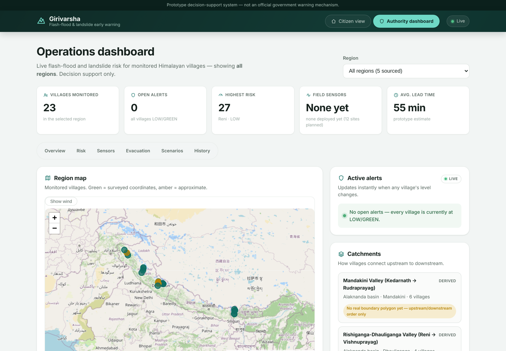
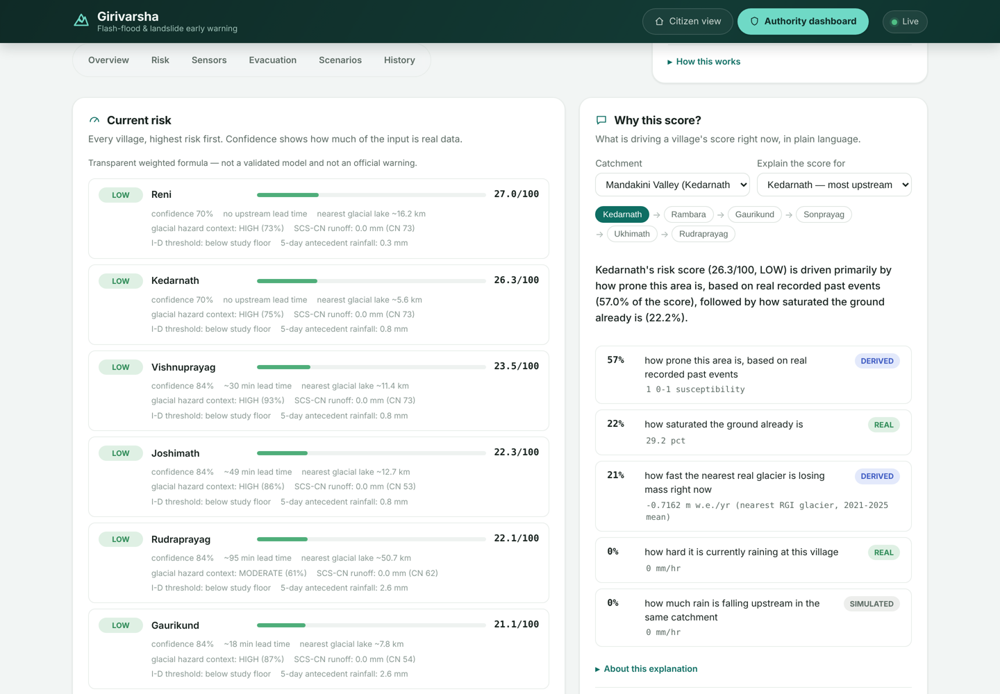
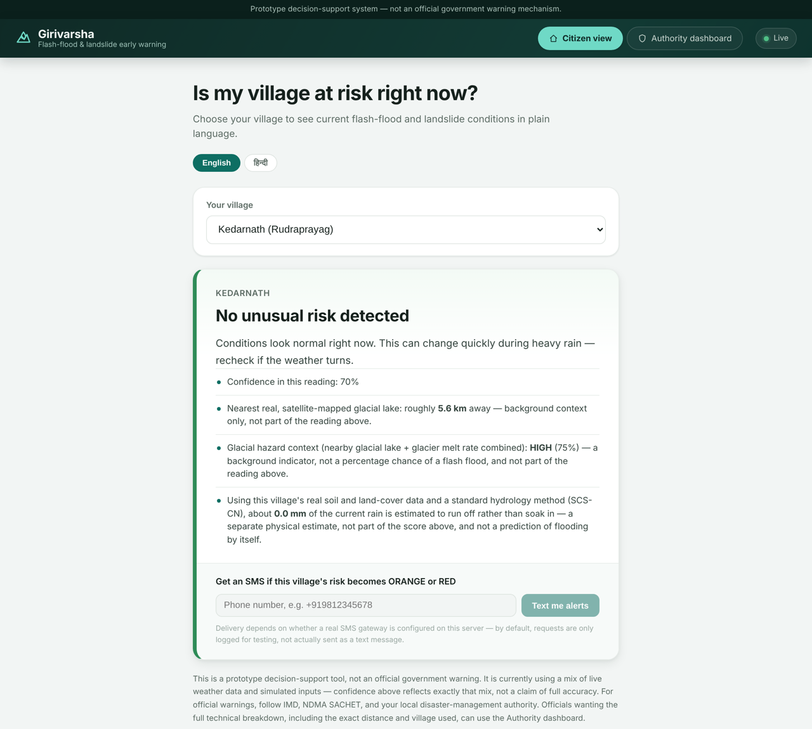

# Girivarsha

**Flash-flood and landslide early warning for Himalayan villages.**

Girivarsha estimates, village by village, how likely a flash flood or landslide is right now — from live rainfall, soil moisture, rain falling upstream in the same valley, the area's disaster history and nearby glacier melt — and explains every score in plain language. It has a simple page for residents and an operations dashboard for district officials.

**Live demo:** [girivarsha.onrender.com](https://girivarsha.onrender.com) · [Authority dashboard](https://girivarsha.onrender.com/authority) · [API](https://girivarsha-api.onrender.com/docs)

> ⚠️ Girivarsha is a prototype decision-support tool, **not an official warning system**. Always follow IMD, NDMA and your district administration. The free hosting sleeps when idle, so the first load can take up to a minute.



## What it does

- **Live risk for 23 villages in five valleys**, each scored 0–100 with a level (LOW → CRITICAL) and a confidence figure that reflects how much of the input is real measured data.
- **"Why this score?"** — ranks what is driving a village's score, picked by catchment and ordered upstream to downstream.
- **Citizen view in English and Hindi** — pick your village, get one clear answer, and opt in to SMS alerts.
- **Live alerts** pushed to the dashboard the moment a village's level changes.
- **Evacuation routes and priority** — shortest route to the lowest settlement in each valley, using real OpenStreetMap roads and trails where they exist.
- **What-if simulator** — try heavier rain or wetter ground and see how the score would change.
- **Historical replay** — step through past disasters moment by moment, from cited sources.
- **Wind map overlay** — current wind across the region.

| Explain a score | Citizen view |
|---|---|
|  |  |

## Regions covered

| Valley | State | Villages | Disaster on record |
|---|---|---|---|
| Mandakini | Uttarakhand | Kedarnath → Rudraprayag (6) | June 2013 Kedarnath flash flood |
| Rishiganga–Dhauliganga | Uttarakhand | Reni → Joshimath (4) | February 2021 Chamoli rock-ice avalanche and flood |
| Lachen Chu–Teesta | Sikkim | Lachen → Rangpo (5) | October 2023 South Lhonak glacial lake outburst |
| Upper Jhelum | Jammu and Kashmir | Verinag → Srinagar (4) | September 2014 Kashmir floods |
| Upper Beas | Himachal Pradesh | Manali → Mandi (4) | July 2023 monsoon floods |

Every village's coordinates, elevation and history are sourced and cited — see [`docs/Data_Sources.md`](docs/Data_Sources.md). [`docs/Region_Onboarding.md`](docs/Region_Onboarding.md) describes how a new valley is added.

## How the score works

The risk score is a **transparent weighted formula**, not a black box: current rainfall, soil saturation, rainfall upstream in the same catchment, recorded past events, and the melt rate of the nearest glacier. Alongside it, the dashboard shows independent indicators that are never folded into the score: SCS-CN rainfall runoff, a published rainfall intensity–duration landslide threshold, glacial-lake proximity and recent rainfall history.

A machine-learning model was trained and tested on real historical data but is **deliberately not deployed** — there aren't yet enough recorded events to validate it (see [`docs/ML_Methodology.md`](docs/ML_Methodology.md)).

## Data sources

| Data | Source |
|---|---|
| Current rainfall and soil moisture | [Open-Meteo](https://open-meteo.com), refreshed hourly |
| Recent rainfall history | [NASA POWER](https://power.larc.nasa.gov) |
| Glacier mass balance | WGMS / Dussaillant et al. (2025) |
| Glacial lakes | Himalaya-wide satellite glacial-lake inventory |
| Soil texture and land cover | ISRIC SoilGrids 2.0, ESA WorldCover |
| Roads and trails | © OpenStreetMap contributors |
| Villages and disasters | Wikipedia, GEER, ESA and other cited reports |

## Honest by design

- Every value is tagged **real**, **derived** or **simulated**, and the UI shows which.
- Nothing is invented to fill a gap: missing data is shown as missing, and unbuilt features say so.
- Each panel has a "How this works" section with its method and limits.
- No field sensors are deployed yet. The dashboard says so instead of showing fake readings; offline sensor sites show a clearly labelled regional weather estimate.

Known limitations are listed in [`docs/Limitations.md`](docs/Limitations.md).

## Tech stack

- **Backend:** Python, FastAPI, SQLAlchemy, PostgreSQL + PostGIS, networkx
- **Frontend:** React, TypeScript, Vite, Leaflet
- **IoT pipeline:** MQTT (Mosquitto) bridge with per-device API keys; ESP32 firmware (untested on hardware)
- **Hosting:** Render (API + static site), Neon (Postgres), GitHub Actions (hourly weather fetch)
- **Tests:** 222 backend, 88 frontend, 2 GIS and 25 ML-pipeline tests

## Run it locally

You need Python 3.11+, Node 20+ and PostgreSQL with PostGIS.

```bash
# backend
cd backend
python3 -m venv .venv && source .venv/bin/activate
pip install -r requirements.txt
cp .env.example .env            # set GIRIVARSHA_DATABASE_URL
alembic upgrade head
python ../scripts/seed_pilot_region.py
python ../scripts/seed_chamoli_valley.py
python ../scripts/seed_new_regions.py
python ../scripts/seed_regions.py
python ../scripts/seed_event_timelines.py
uvicorn app.main:app --reload    # http://localhost:8000

# frontend (second terminal)
cd frontend
npm install
npm run dev                      # http://localhost:5173
```

Set `GIRIVARSHA_ACTIVE_RAINFALL_PROVIDER=real` and `GIRIVARSHA_ACTIVE_SOIL_PROVIDER=real` in `backend/.env` for live weather. Deployment is described in [`docs/Deployment.md`](docs/Deployment.md); the optional sensor pipeline in [`iot/README.md`](iot/README.md).

## Documentation

[Architecture](docs/Architecture.md) · [API](docs/API_Documentation.md) · [Data sources](docs/Data_Sources.md) · [Limitations](docs/Limitations.md) · [ML methodology](docs/ML_Methodology.md) · [GIS methodology](docs/GIS_Methodology.md) · [IoT architecture](docs/IoT_Architecture.md) · [Deployment](docs/Deployment.md) · [Technical build notes](docs/Technical_Notes.md)
